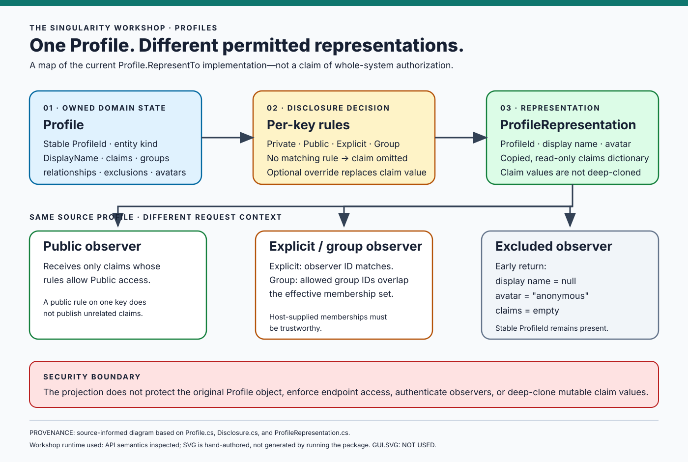

# Profiles Gallery

Profiles is a provider-neutral domain model for describing an entity, its claims, and the information that a particular observer may receive. This gallery connects the ideas to the current source and diagrams, while stating plainly what has been implemented, what the visuals demonstrate, and what still requires host-level enforcement.

## 1. One profile, different representations



**What this teaches:** A `Profile` owns domain information; `RepresentTo` creates a `ProfileRepresentation` based on the observer context, exclusions, claim disclosure rules, display-name policy, and avatar precedence.

**What it demonstrates:** The diagram is source-informed and hand-authored after inspecting the current implementation. Its own footer records the source scope and states that GUI.SVG was not used to generate it.

**What it does not prove:** It is not a runtime capture, a generated source graph, or proof of application-wide authorization. The original `Profile` remains readable to code that already holds it; host applications must enforce access control at every relevant boundary.

- [Theory](docs/THEORY.md) — why identity, information, disclosure, and representation are separate.
- [Architecture](docs/ARCHITECTURE.md) — the actual projection flow and package boundaries.
- [Privacy model](docs/PRIVACY.md) — the intended privacy properties and explicit limitations.

## 2. Try the domain model

Install the package in a .NET 8 application:

```bash
dotnet add package TheSingularityWorkshop.Profiles
```

A minimal example is included in the [README](README.md#04-see-it-in-a-minute). It creates a profile, adds a claim, defines disclosure, and requests an observer-specific representation. Treat the README example as source-shaped unless a build/test run for the exact revision has been recorded.

## 3. Follow the concept through the source

| Question | Read next |
|---|---|
| What does a Profile mean? | [Domain definition](docs/DOMAIN_DEFINITION.md) |
| How is an observer-specific representation formed? | [Architecture](docs/ARCHITECTURE.md) |
| Why are unknown, not-satisfied, and satisfied distinct? | [Theory](docs/THEORY.md) |
| What is a consumer expected to do? | [Consuming guide](docs/CONSUMING.md) |
| How do I perform a common task? | [How-to guide](docs/HOW_TO.md) |
| What does the public API expose? | [API map](docs/API.md) and XML API documentation |
| What are the release and package checks? | [Publishing checklist](docs/PUBLISHING.md) |

## 4. Living documentation: current state and intended direction

The Workshop's goal is to make diagrams explanatory views of the software's semantic model, not decorative images maintained independently from it.

The current Profiles architecture SVG is **hand-authored and source-informed**. It documents a checked implementation flow and labels its provenance. It is not yet generated by GUI.SVG, reflection, or a source-analysis pipeline. This distinction is deliberate: a picture must not be called “living” merely because it is an SVG file.

A stronger future workflow can progressively connect:

1. **Source and tests** — identify the exact project, declarations, behaviors, and test evidence being described.
2. **Normalized semantic model** — preserve stable type identity, source locations, explicit relationship kinds, and provenance.
3. **Renderer-neutral diagram model** — separate meaning and relationships from visual layout.
4. **GUI.SVG manifestation** — render a readable visual that can evolve with the underlying model.
5. **Verification** — regenerate or compare the expected output in CI, report unresolved relationships, and make the source revision and generation method visible.

Reflection can describe runtime-visible types and members, but it is not a complete syntax tree and cannot infer user intent. Source analysis can describe declarations and relationships, but does not prove runtime behavior. Tests and captured runtime observations provide different evidence and should be labeled separately.

### A useful diagram must answer

- What is the subject of this picture?
- Which source revision and analysis scope does it represent?
- Which relationships are verified, conceptual, inferred, or unresolved?
- What does the picture help a reader understand?
- What behavior does it **not** establish?
- How can the reader follow the picture to the relevant explanation, source, and tests?

## 5. Verification

Use the repository's [publishing checklist](docs/PUBLISHING.md) for the complete validation sequence. The core build and tests can be run with:

```bash
dotnet restore TheSingularityWorkshop.Profiles.csproj
dotnet build TheSingularityWorkshop.Profiles.csproj --configuration Release
dotnet test tests/TheSingularityWorkshop.Profiles.Tests/TheSingularityWorkshop.Profiles.Tests.csproj --configuration Release
```

A successful local command is evidence for that execution only. Consult the current GitHub Actions results for the revision under review before claiming CI is green or a release is ready.

## 6. Boundaries worth remembering

- A representation is a filtered projection, **not** complete application-wide access control.
- A verification timestamp is metadata, not proof that a trusted authority validated a claim.
- An external identity binding describes a mapping; it does not authenticate the caller.
- Disclosure does not imply licensing, and licensing policy does not execute a transaction.
- Profiles is independently useful and does not require FSM_COS, a particular database, an authentication provider, or a renderer.
