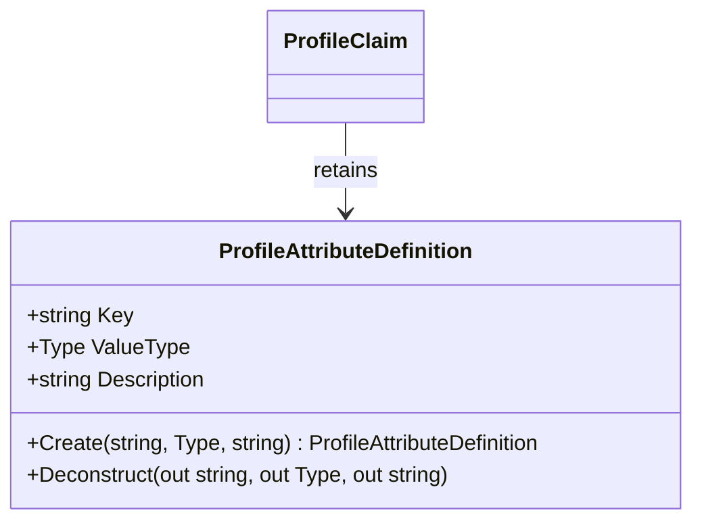

<!-- The Singularity Workshop moniker -->
<p align="center"><a href="https://github.com/TrentBest"></a></p>

# `ProfileAttributeDefinition`

## 01 — What

`ProfileAttributeDefinition` is a sealed record that gives a profile attribute a stable string key, an expected CLR `Type`, and an optional human-readable description.

Source: [ProfileAttributeDefinition.cs](../../ProfileAttributeDefinition.cs).

## 02 — Why

A claim needs more than a raw object value: consumers need a stable semantic key and an explicit runtime type contract. The definition provides that metadata without imposing a database schema, serialization format, global registry, or application-specific vocabulary.

## 03 — How

### Declaration and public members

- **Kind:** `public sealed record`.
- **Constructor:** `ProfileAttributeDefinition(string key, Type valueType, string? description = null)`.
- **Properties:** `Key`, `ValueType`, and nullable `Description`, all get-only.
- **Factory:** `Create(string key, Type valueType, string? description = null)`.
- **Deconstruction:** returns the three constructor values.

The constructor rejects a null/blank key and a null `valueType`. It does not validate a particular vocabulary, register the type globally, or validate future values; value validation occurs when a `ProfileClaim` is constructed.

### Relationships and ownership

`ProfileClaim` retains a reference to its definition and uses `ValueType.IsInstanceOfType` to validate the supplied value. The definition itself is immutable after construction and contains no mutable collection or external resource.

### Example

```csharp
var language = ProfileAttributeDefinition.Create(
    "language",
    typeof(string),
    "Preferred language.");

var claim = new ProfileClaim(language, "en-US");
```

This is a source-shaped example. The construction and deconstruction validation is covered by [ProfileTests.cs](../../tests/TheSingularityWorkshop.Profiles.Tests/ProfileTests.cs), and the consumer example is exercised by [ConsumerGuideExamplesTests.cs](../../tests/TheSingularityWorkshop.Profiles.Tests/ConsumerGuideExamplesTests.cs).

### Limits

- The key is a string, not a centrally governed enum or schema identifier.
- The CLR type check is an in-process assignability check, not serialization or cross-process schema validation.
- A definition does not establish the truth, provenance, or disclosure policy of a claim.

## 04 — See it in a minute



## 05 — Choose your next step

- [ProfileClaim type reference](ProfileClaim.md)
- [ProfileClaim neighborhood and use cases](../UML/ProfileClaimUML.md)
- [API map](../API.md)
- [Implementation](../../ProfileAttributeDefinition.cs)

<!-- THE SINGULARITY WORKSHOP FOOTER -->
<p align="center"></p>
