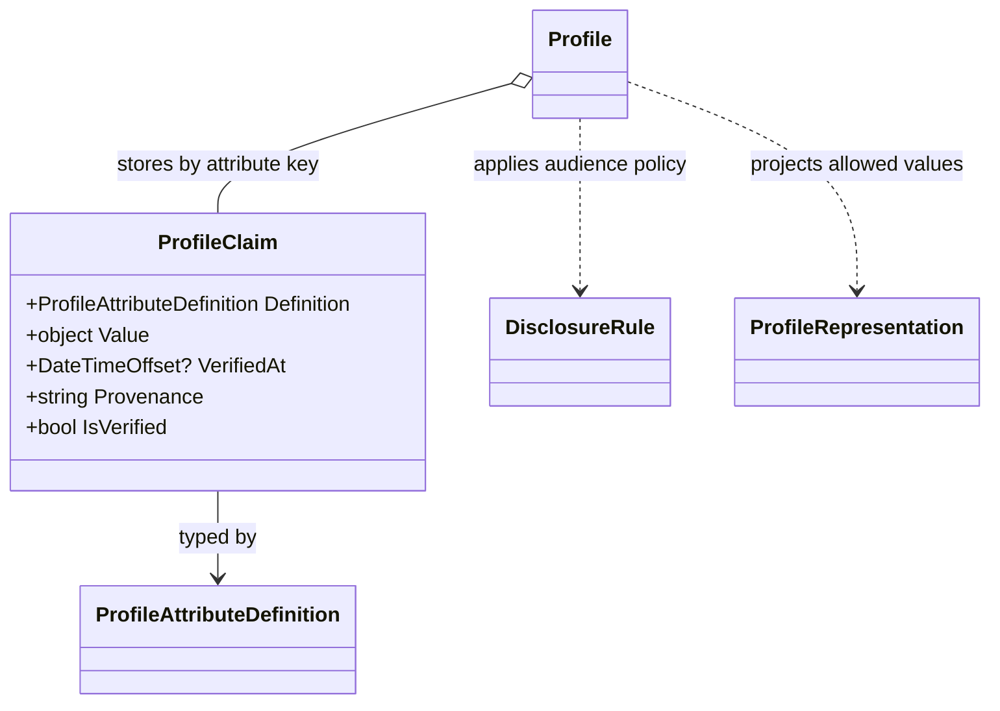

<!-- The Singularity Workshop moniker -->
<p align="center"><a href="https://github.com/TrentBest"></a></p>

# `ProfileClaim`

## 01 — What

`ProfileClaim` is a sealed reference type representing one typed micro-data value held by a profile. It retains its `ProfileAttributeDefinition`, the supplied value, and optional verification time and provenance text.

Source: [ProfileClaim.cs](../../ProfileClaim.cs).

## 02 — Why

Profiles needs to distinguish the existence of a value from claims about how that value was obtained or verified. The claim carries those pieces of metadata together while leaving verification authority, persistence, disclosure, and trust decisions to the consuming system.

## 03 — How

### Declaration and public members

- **Kind:** `public sealed class`.
- **Constructor:** `ProfileClaim(ProfileAttributeDefinition definition, object value, DateTimeOffset? verifiedAt = null, string? provenance = null)`.
- **Properties:** `Definition`, `Value`, nullable `VerifiedAt`, nullable `Provenance`.
- **Derived property:** `IsVerified` is true exactly when `VerifiedAt` has a value.

Construction rejects a null definition, null value, or value that is not assignable to the definition's `ValueType`. The value is retained by reference; it is not deep-cloned.

### Relationships and mutability

- `Profile` stores claims by `Definition.Key`; setting another claim with the same key replaces the existing entry.
- `ProfileAttributeDefinition` provides the key and expected CLR type.
- `DisclosureRule` controls whether a claim is included in a representation and may substitute a different representation value.
- The claim's properties are get-only, but `Value` is an arbitrary object. Mutable payloads can therefore change after construction. Prefer immutable value objects or treat payloads as immutable while the claim is in use.

### Example

```csharp
var role = ProfileAttributeDefinition.Create("role", typeof(string));
var claim = new ProfileClaim(
    role,
    "architect",
    DateTimeOffset.UtcNow,
    provenance: "trusted-provider");

bool hasVerificationTimestamp = claim.IsVerified;
```

The constructor type check and verification/provenance retention are covered by [ProfileTests.cs](../../tests/TheSingularityWorkshop.Profiles.Tests/ProfileTests.cs). The end-to-end claim/disclosure example is exercised by [ConsumerGuideExamplesTests.cs](../../tests/TheSingularityWorkshop.Profiles.Tests/ConsumerGuideExamplesTests.cs).

### Limits and security boundary

- `IsVerified` means only that a timestamp was supplied; it does not validate the verifier, source, evidence, freshness, or legal authority.
- `Provenance` is descriptive metadata, not a cryptographic signature or trust chain.
- Type compatibility does not prove that a value is accurate.
- A claim's existence does not make it public. Disclosure requires a separate rule and observer-specific representation.
- The value is not deep-cloned. A read-only dictionary containing a claim value does not make that arbitrary value immutable.

## 04 — See it in a minute



## 05 — Choose your next step

- [ProfileAttributeDefinition type reference](ProfileAttributeDefinition.md)
- [ProfileClaim target-centered UML and use cases](../UML/ProfileClaimUML.md)
- [Disclosure API](../API.md#disclosure)
- [Profile aggregate](Profile.md)
- [Implementation](../../ProfileClaim.cs)

<!-- THE SINGULARITY WORKSHOP FOOTER -->
<p align="center"></p>
