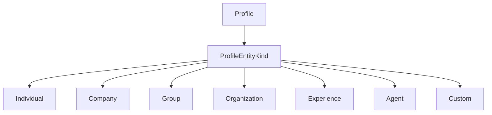

<!-- The Singularity Workshop moniker -->
<p align="center"><a href="https://github.com/TrentBest"></a></p>

# ProfileEntityKind

## 01 — What

`ProfileEntityKind` is the enum that classifies the broad kind of entity represented by a `Profile`.

## 02 — Why

Profiles are not limited to individual people. The same identity and disclosure boundary can represent companies, groups, organizations, experiences, and autonomous agents without forcing those concepts into separate profile implementations.

The enum supplies a small shared vocabulary. It is not a complete ontology, a legal classification system, or a substitute for application-specific attributes and relationships.

## 03 — How

**Declaration:** `public enum ProfileEntityKind` in [ProfileEntityKind.cs](../../ProfileEntityKind.cs).

| Value | Intended meaning |
|---|---|
| `Individual` | An individual person or agent. |
| `Company` | A company or commercial entity. |
| `Group` | A social or functional group. |
| `Organization` | An organization or institution. |
| `Experience` | An experience or world. |
| `Agent` | A machine or autonomous agent. |
| `Custom` | An application-defined entity kind where the shared values are insufficient. |

The enum values are implicitly numbered in declaration order. Consumers should persist or exchange the symbolic names (or define an explicit versioned mapping) rather than assume the underlying integer values are a permanent wire or database contract.

### Use with Profile

`Profile` requires a defined enum value in its constructor and throws `ArgumentOutOfRangeException` for an undefined numeric value. Its `Kind` property is read-only after construction.

```csharp
var person = new Profile(ProfileEntityKind.Individual, "Ari");
var studio = new Profile(ProfileEntityKind.Company, "Northstar Studio");
var world = new Profile(ProfileEntityKind.Experience, "Workshop");
var agent = new Profile(ProfileEntityKind.Agent);
```

Use `Custom` when a domain-specific category does not fit the shared vocabulary. Store the additional meaning in application-owned metadata; do not reinterpret one of the existing values.

### Ownership and boundaries

- The Profiles package owns the enum vocabulary and validates it when a Profile is created.
- Consumers own the meaning and lifecycle of application-specific classifications.
- The enum does not establish that an entity legally exists, that an agent is trustworthy, or that a caller is authorized to act for the entity.
- The enum does not imply different persistence, authentication, or disclosure mechanics by itself.

### Evidence

- Source: [ProfileEntityKind.cs](../../ProfileEntityKind.cs), [Profile.cs](../../Profile.cs).
- Tests: [ProfileTests.cs](../../tests/TheSingularityWorkshop.Profiles.Tests/ProfileTests.cs) — `AllSupportedEntityKindsCanBeRepresented` checks every declared enum value, and `RelationshipsRejectUninitializedEndpointsAndBlankTypes` verifies rejection of an undefined numeric value.

## 04 — See it in a minute



The enum classifies the profile entity; it does not create a separate type hierarchy or dictate the entity's storage model.

## 05 — Choose your next step

- [Profile](Profile.md) — the aggregate that consumes this classification.
- [ProfileId](ProfileId.md) — the opaque identifier shared across entity kinds.
- [API map](../API.md) — the domain-wide public type map.
- [UML inventory](../UML/README.md) — the complete declared-type inventory.

<!-- THE SINGULARITY WORKSHOP FOOTER -->
<p align="center"></p>
