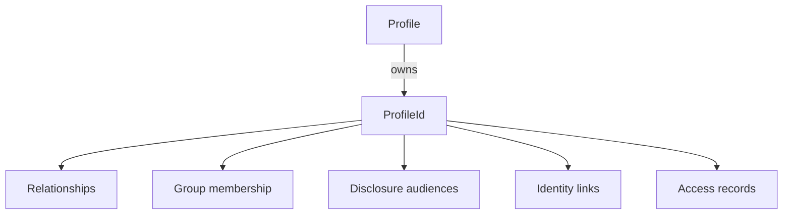

<!-- The Singularity Workshop moniker -->
<p align="center"><a href="https://github.com/TrentBest"></a></p>

# ProfileId

## 01 — What

`ProfileId` is the compact, opaque identity value used to refer to one profile entity throughout the Profiles domain.

## 02 — Why

Domain relationships, observer lists, group membership, exclusions, and identity mappings need a stable reference that does not make a person's name or an external provider identifier the primary key.

## 03 — How

**Declaration:** `public readonly record struct ProfileId(Guid Value)` in [ProfileId.cs](../../ProfileId.cs).

| Member | Contract |
|---|---|
| `Value` | The underlying GUID value. |
| `New()` | Creates a new identifier using `Guid.NewGuid()`. |
| `ToString()` | Returns the GUID in standard `D` format. |

The type is a value type and is immutable after construction. The all-zero/default value is representable by the CLR, so APIs that require an initialized ID validate it at their own boundaries. Creating or possessing a `ProfileId` is not authentication, authorization, or proof of legal identity.

### Domain relationships

`Profile` creates its own ID during construction. Group membership, disclosure audience lists, profile relationships, exclusions, access records, identity links, and external identity bindings refer to profiles through this value.

### Example

```csharp
var profile = new Profile(ProfileEntityKind.Individual);
ProfileId profileId = profile.Id;
ProfileId observerId = ProfileId.New();
```

### Evidence

- Source: [ProfileId.cs](../../ProfileId.cs), [Profile.cs](../../Profile.cs).
- Tests: [ProfileTests.cs](../../tests/TheSingularityWorkshop.Profiles.Tests/ProfileTests.cs) — identifier uniqueness, default-ID rejection across domain boundaries, and identity-related workflows.
- Compile-checked consumer path: [ConsumerGuideExamplesTests.cs](../../tests/TheSingularityWorkshop.Profiles.Tests/ConsumerGuideExamplesTests.cs).

## 04 — See it in a minute



The diagram shows domain references, not a database schema or a claim that all of these collections are stored by `Profile`.

## 05 — Choose your next step

- [Profile](Profile.md) — the aggregate that creates and owns a profile ID.
- [API map](../API.md) — the domain-wide public type map.
- [UML inventory](../UML/README.md) — the full declared-type list and documentation coverage.

<!-- THE SINGULARITY WORKSHOP FOOTER -->
<p align="center"></p>
