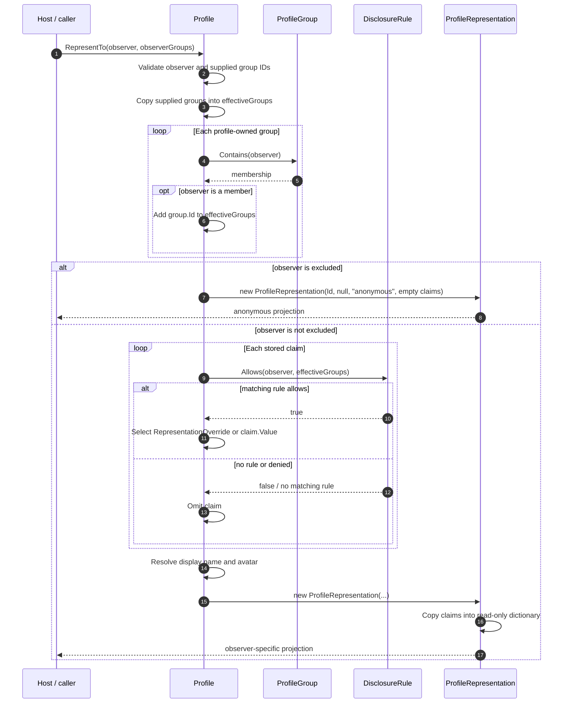
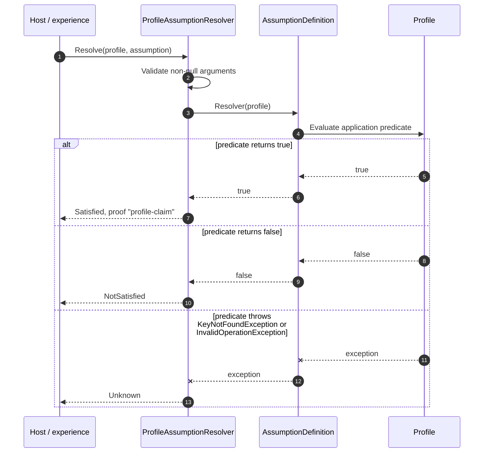

<!-- The Singularity Workshop moniker -->

# Profiles — source-backed interaction sequences

## 01 — What

This page describes two workflows that cross public Profiles contracts: observer-specific representation and assumption resolution. The diagrams are hand-authored from the current `development` source; they are not runtime traces or generated call graphs.

## 02 — Why

Class diagrams show ownership and type relationships, but they do not show the order in which a host supplies context, the domain evaluates policy, and a result is returned. These sequences make the boundaries and failure semantics visible.

## 03 — How

### SEQ-PROFILE-01 — Build an observer-specific representation

**Entry point:** `Profile.RepresentTo(ProfileId observer, IReadOnlySet<ProfileId>? observerGroups)` in [Profile.cs](../../Profile.cs).

**Source-grounded behavior and alternatives**

- Uninitialized observer or supplied group IDs are rejected before projection.
- Group memberships recorded on the profile are added to the effective group set; supplied groups are trusted host context and are not authenticated by Profiles.
- Exclusion short-circuits normal disclosure and returns the stable profile ID, null display name, `anonymous` avatar, and no claims.
- A claim without a matching rule is omitted. A matching rule may deny it or substitute `RepresentationOverride` for the stored value.
- Display name is resolved separately through the `display-name` rule. Avatar resolution follows observer-specific, matching-group, public/default, then anonymous precedence.
- The returned representation copies the claims dictionary structure, but does not deep-clone arbitrary claim payload objects.

**Failure boundary:** exceptions from ID validation or underlying collection operations are not converted into an anonymous result. This sequence describes the method's ordinary successful and excluded paths, not every possible exception.

### SEQ-ASSUMPTION-01 — Resolve a proposition against a profile

**Entry point:** `ProfileAssumptionResolver.Resolve(Profile, AssumptionDefinition)` in [Assumptions.cs](../../Assumptions.cs).

**Source-grounded behavior and alternatives**

- The supplied predicate receives the original `Profile`, not a filtered `ProfileRepresentation`; it may inspect raw claims.
- `KeyNotFoundException` and `InvalidOperationException` map to `Unknown`.
- Other exception types propagate; the resolver does not catch every failure.
- The `profile-claim` proof string is a descriptive label, not cryptographic evidence or independent verification.
- Consumers needing a strict distinction must inspect `AssumptionResult.Kind`; `IsSatisfied` is true only for `Satisfied`.

## 04 — See it in a minute

| Workflow | Implementation | Test evidence |
|---|---|---|
| Observer-specific projection | [Profile.RepresentTo](../../Profile.cs), [DisclosureRule.Allows](../../Disclosure.cs), [ProfileRepresentation](../../ProfileRepresentation.cs) | [ProfileTests.cs](../../tests/TheSingularityWorkshop.Profiles.Tests/ProfileTests.cs) — disclosure, exclusion, overrides, display name, group membership |
| Assumption resolution | [ProfileAssumptionResolver.Resolve](../../Assumptions.cs) | [ConsumerGuideExamplesTests.cs](../../tests/TheSingularityWorkshop.Profiles.Tests/ConsumerGuideExamplesTests.cs) — satisfied path; no dedicated resolver exception matrix was found in the inspected test project |

Test links identify existing assertions, not a claim that every branch in the sequence is tested. No tests were run while authoring this page.

## 05 — Choose your next step

- [Profile target-centered UML](ProfileTypeUML.md) for the aggregate's structural neighborhood and use cases.
- [ProfileClaim target-centered UML](ProfileClaimUML.md) for claim storage, metadata, and disclosure.
- [Architecture](../ARCHITECTURE.md) for domain and host responsibility boundaries.
- [Privacy model](../PRIVACY.md) for the limits of disclosure, assumptions, and enforcement.

<!-- THE SINGULARITY WORKSHOP FOOTER -->

