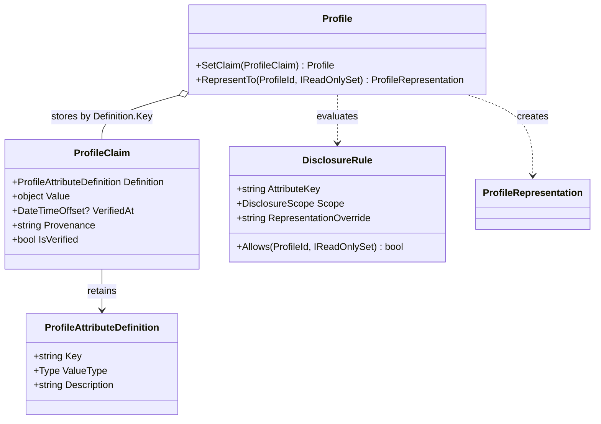

<!-- The Singularity Workshop moniker -->

# `ProfileClaim` — target-centered UML

## Scope and provenance

- **Target:** `TheSingularityWorkshop.Profiles.ProfileClaim`.
- **Sources:** [ProfileClaim.cs](../../ProfileClaim.cs), [ProfileAttributeDefinition.cs](../../ProfileAttributeDefinition.cs), and the claim storage/projection methods in [Profile.cs](../../Profile.cs).
- **Evidence:** human-authored and source-checked against `development`; not generated.
- **Scan scope:** target declaration and directly relevant domain relationships, plus the named test cases. This is not a repository-wide call graph.

## Neighborhood

The source shows that a profile stores a claim under its definition key. During representation, the profile includes the claim's value only when the matching disclosure rule allows the observer; a rule override can replace the underlying value. The claim itself does not decide whether it may be disclosed.

## Users / consumers

Known in-repository callers include:

- [Profile.SetClaim and Profile.RepresentTo](../../Profile.cs).
- [ProfileTests.cs](../../tests/TheSingularityWorkshop.Profiles.Tests/ProfileTests.cs).
- [ConsumerGuideExamplesTests.cs](../../tests/TheSingularityWorkshop.Profiles.Tests/ConsumerGuideExamplesTests.cs).

This list is scoped to the inspected implementation and tests; it is not an exhaustive external-consumer inventory.

## Use cases

### UC-CLAIM-01 — Define and store a typed claim

- **Actor:** consuming application/domain code.
- **Goal:** attach a value to a profile under a stable attribute key.
- **Preconditions:** an initialized profile and a definition with a nonblank key and CLR value type.
- **Success:** the claim accepts an assignable non-null value and `Profile.SetClaim` stores it under `Definition.Key`.
- **Alternatives/failures:** null values and incompatible runtime types are rejected; setting the same key replaces the prior claim.
- **Evidence:** constructors in [ProfileAttributeDefinition.cs](../../ProfileAttributeDefinition.cs) and [ProfileClaim.cs](../../ProfileClaim.cs); type-check and storage tests in [ProfileTests.cs](../../tests/TheSingularityWorkshop.Profiles.Tests/ProfileTests.cs).

### UC-CLAIM-02 — Attach verification metadata

- **Actor:** trusted application integration.
- **Goal:** retain a verification timestamp and descriptive provenance with a claim.
- **Preconditions:** the integration has independently decided what metadata to supply.
- **Success:** the timestamp and provenance are retained; `IsVerified` reflects timestamp presence.
- **Limit:** Profiles does not validate the authority, evidence, or truth represented by these fields.
- **Evidence:** `ClaimsRetainVerificationAndProvenance` in [ProfileTests.cs](../../tests/TheSingularityWorkshop.Profiles.Tests/ProfileTests.cs).

### UC-CLAIM-03 — Project a claim to an observer

- **Actor:** host code requesting a representation.
- **Goal:** disclose only the observer-authorized value.
- **Preconditions:** the profile has a claim and an applicable disclosure rule.
- **Success:** `Profile.RepresentTo` includes the claim only when the rule allows the observer; a representation override may substitute the exposed value.
- **Alternatives:** absent or denying rules omit the claim.
- **Evidence:** `PublicClaimIsIncluded`, `PrivateClaimDoesNotLeak`, and `RepresentationOverrideCanReplaceSensitiveValue` in [ProfileTests.cs](../../tests/TheSingularityWorkshop.Profiles.Tests/ProfileTests.cs).

## Ownership and performance notes

- The definition and claim property surfaces are immutable after construction, but the arbitrary claim payload is retained by reference.
- The profile owns the claim mapping, not a deep copy of the payload.
- Dictionary insertion/lookup is expected O(1); representing a profile scans its claims, so claim processing is O(C) expected for C stored claims, excluding group membership work.
- These are source-level collection estimates, not measured benchmark results.

## Further reading

- [ProfileClaim type reference](../Types/ProfileClaim.md)
- [ProfileAttributeDefinition type reference](../Types/ProfileAttributeDefinition.md)
- [Profile aggregate UML](ProfileTypeUML.md)
- [Privacy model](../PRIVACY.md)

<!-- THE SINGULARITY WORKSHOP FOOTER -->

