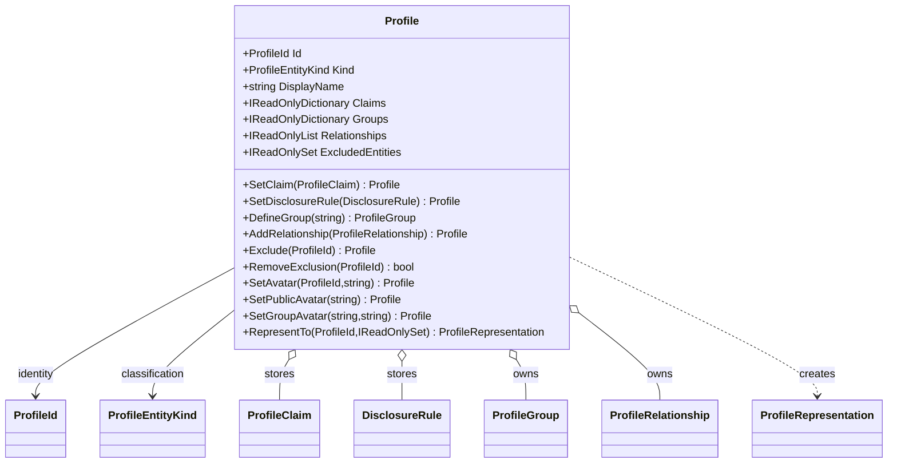

<!-- The Singularity Workshop moniker -->

# `Profile` — target-centered UML

## Scope and provenance

- **Target:** `TheSingularityWorkshop.Profiles.Profile`
- **Source:** [Profile.cs](../../Profile.cs)
- **Evidence class:** human-authored, source-checked against the current `development` source.
- **Scan scope:** the Profile declaration and directly referenced public domain types; not a repository-wide Roslyn call graph.
- **Limit:** this page is not generated, does not enumerate every consumer, and does not prove runtime execution order.

## Neighborhood

**Relationship notes:** The aggregate stores claims, disclosure rules, groups, and relationships in private collections. It returns a representation through `RepresentTo`. This diagram is a compact contract view; it does not show all private fields, constructors, or every type appearing in method signatures.

## Users / consumers

The library exposes Profile as its primary aggregate. This page does not claim a complete list of consumers; no repository-wide symbol scan was performed. Tests and consumer examples are known callers:

- [ProfileTests.cs](../../tests/TheSingularityWorkshop.Profiles.Tests/ProfileTests.cs)
- [ConsumerGuideExamplesTests.cs](../../tests/TheSingularityWorkshop.Profiles.Tests/ConsumerGuideExamplesTests.cs)

## Dependencies and boundaries

- `ProfileId` identifies the profile and observer/group identities.
- `ProfileEntityKind` classifies the represented entity.
- `ProfileClaim` stores typed micro-data.
- `DisclosureRule` evaluates observer/group audience eligibility and optional representation substitution.
- `ProfileGroup` supplies profile-owned membership context.
- `ProfileRelationship` models profile-owned semantic relationships.
- `ProfileRepresentation` is the projection returned to a consumer.

No external package dependency or persistence provider is implied by these domain relationships.

## Use cases

### UC-PROFILE-01 — Create an entity profile

- **Actor:** consuming application/domain service.
- **Goal:** establish a new in-memory profile for an entity.
- **Trigger/preconditions:** host has decided an entity needs a Profiles domain representation.
- **Success:** constructor validates entity kind and creates a new stable ProfileId.
- **Alternatives/failures:** undefined entity kind throws `ArgumentOutOfRangeException`.
- **Evidence:** constructor in [Profile.cs](../../Profile.cs); profile construction tests in [ProfileTests.cs](../../tests/TheSingularityWorkshop.Profiles.Tests/ProfileTests.cs).

### UC-PROFILE-02 — Disclose a claim to an observer

- **Actor:** trusted host/application code.
- **Goal:** create a limited representation for a particular observer context.
- **Trigger/preconditions:** host supplies an initialized observer ID and, when needed, trusted group IDs.
- **Success:** only claims with an allowing disclosure rule are included; display name and avatar follow their separate resolution rules.
- **Alternatives/failures:** invalid IDs throw; excluded observers receive the anonymous empty projection; missing/denying rules omit claims.
- **Evidence:** `Profile.RepresentTo`, `DisclosureRule.Allows`, and Profile representation tests.

### UC-PROFILE-03 — Exclude an observer

- **Actor:** host-authorized profile-management code; the domain object itself does not authenticate an owner.
- **Goal:** ensure a selected observer receives the anonymous projection.
- **Trigger/preconditions:** initialized observer ProfileId.
- **Success:** observer is added to the exclusion set; later representations for that observer contain no claims and no display name.
- **Alternatives/failures:** invalid/empty observer ID is rejected.
- **Evidence:** `Exclude`, `RemoveExclusion`, and exclusion tests in [ProfileTests.cs](../../tests/TheSingularityWorkshop.Profiles.Tests/ProfileTests.cs).

## Complexity and performance

This is a source-level qualitative assessment, not a benchmark:

| Operation | Dominant work | Expected shape |
|---|---|---|
| `SetClaim`, `SetDisclosureRule`, `Exclude` | Dictionary/hash-set insertion | Expected O(1) |
| `RepresentTo` | Membership scan plus claim scan | O(G + C) expected, where G is profile group count and C is claim count; hash lookups are expected O(1) |
| Avatar group resolution | Scan matching profile groups | O(G) worst case |

These are collection-operation estimates, not wall-clock guarantees. No numeric performance claim is made.

## Further reading

- [Profile type page](../Types/Profile.md)
- [Aggregate UML](ProfileUML.md)
- [Architecture](../ARCHITECTURE.md)
- [Privacy](../PRIVACY.md)

<!-- THE SINGULARITY WORKSHOP FOOTER -->

