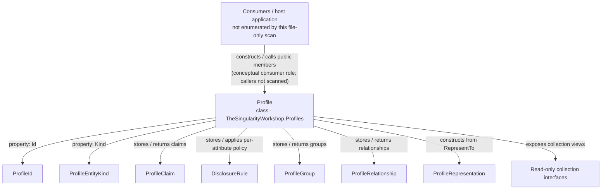

# Profile — target-centered UML and use cases

> **Status:** Source-checked structural guide; not generated.  
> **Target:** `TheSingularityWorkshop.Profiles.Profile`  
> **Source:** [`Profile.cs`](../../Profile.cs) on `development` (source inspected for this guide).  
> **Scope:** One declaration and its visible member signatures/implementation. This is not a repository-wide consumer scan and does not claim to enumerate every caller.

## Plain-language purpose

A `Profile` is the domain boundary for one entity's information. It owns claims, disclosure rules, groups, relationships, exclusions, and avatar choices. When an application asks `RepresentTo(observer)`, the class creates a separate `ProfileRepresentation` containing the information permitted for that observer.

Think of it like a controlled information desk: the original profile is the maintained record; a representation is the specific packet prepared for a visitor. The analogy stops at the package boundary: this class does **not** protect the original object from code that already holds it, authenticate the observer, or enforce security across a host application.

## Target-centered structural view

**Relationship legend:** arrows above the target represent the expected consumer role, not a proven list of callers. Arrows below are source-checked type/member relationships in `Profile.cs`; they do not imply execution order. This view omits types whose relationships have not been checked and is not a complete dependency graph.

## Public responsibilities visible in the source

- **Identity and kind:** `Id`, `Kind`, and optional `DisplayName`.
- **Claims and disclosure:** `SetClaim`, `SetDisclosureRule`, and `PublicAttributeKeys`.
- **Audience structure:** `DefineGroup`, `AddRelationship`, `Exclude`, and `RemoveExclusion`.
- **Presentation policy:** `SetAvatar`, `SetPublicAvatar`, and `SetGroupAvatar`.
- **Projection:** `RepresentTo` combines trusted/recorded group context, exclusions, per-claim disclosure rules, display-name policy, and avatar resolution to create a `ProfileRepresentation`.

The read-only collection wrappers prevent callers from changing the exposed collection structure through those interfaces. They do not deep-clone arbitrary claim values, and they do not make the mutable `Profile` itself a security boundary.

## Use cases

1. **Describe an entity.** Construct a `Profile` with an allowed `ProfileEntityKind` and optional display name.
2. **Add a claim without automatically publishing it.** Call `SetClaim`, then define the relevant disclosure rule explicitly.
3. **Prepare observer-specific information.** Call `RepresentTo` and pass the resulting representation—not the complete profile—to a component that should receive only the projection.
4. **Exclude an observer from the projection.** Call `Exclude`; the source returns an anonymous representation with no display name or claims for that observer. This does not revoke access to a `Profile` object already held elsewhere.
5. **Use group- or observer-specific appearance.** Configure avatars while leaving rendering to the consuming presentation system.

## Verification and provenance

- Source entry point: [`Profile.cs`](../../Profile.cs).
- Related contracts: [API map](../API.md), [domain definition](../DOMAIN_DEFINITION.md), [architecture](../ARCHITECTURE.md), [privacy model](../PRIVACY.md).
- To verify behavior, run the repository test project: `dotnet test tests/TheSingularityWorkshop.Profiles.Tests/TheSingularityWorkshop.Profiles.Tests.csproj --configuration Release`.
- This page has **not** been generated by GUI.SVG or a reflection/AST pipeline. The Mermaid view is authored from the inspected source and is not runtime evidence.
- No repository-wide call graph was generated. A later automated version should retain stable type identities, source spans, relationship kinds, scan scope, and provenance; tests or human-authored use cases must remain separate from source structure.
